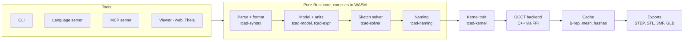

# TextCAD Format — Requirements Specification

Oct 18, 2026 · Adam

## 0. Instructions for the coding agent

Build Phase 1 end to end, autonomously, in a new GitHub repository; do not start Phase 2 until every Phase 1 acceptance criterion (section 14) passes in CI.

- **Source of truth.** This document is the requirement. Where it is silent or ambiguous, pick the most reasonable option and keep going; do not stop to ask.
- **Decision records.** Log every non-trivial choice as an Architecture Decision Record in `docs/adr/NNNN-title.md` (context, options, decision, consequences). Locked decisions in section 2 may not be overturned by an ADR.
- **Spec first, code second.** Every language construct is defined in `spec/` (normative prose plus grammar) before it is implemented. Implementation and spec must never disagree; if they do, fix one and log an ADR.
- **Small, green steps.** Work in milestones (M1–M8, section 14). Each milestone ends with passing CI, an updated `CHANGELOG.md` and a short `docs/progress.md` entry.
- **Working name.** The format is called **TextCAD**, extension `.tcad`, bundle extension `.tcadz` for archived bundles. Keep the name in one constant per crate and in `spec/name.md` so it can be renamed later.
- **Out of scope until its phase.** Do not implement Phase 2+ features, but the grammar must reserve their keywords (section 4.8) so Phase 1 files stay valid later.

## 1. Vision, goals and non-goals

TextCAD is an open, human- and LLM-readable text format that carries full parametric design intent and can, by Phase 5, replace proprietary native CAD formats (.prt, .sldprt, .ipt, Parasolid-native files) for mechanical design.

**Goals**

1. Store the complete design recipe: parameters, sketches, constraints, feature tree, references, configurations.
2. Regenerate the same geometry on any conforming kernel implementation (section 8).
3. Be diffable and mergeable in git with meaningful, line-oriented diffs.
4. Be easy for LLM agents to read, write, query and repair, with structured errors.
5. Interoperate through STEP AP242 and mesh formats so users never get stranded.
6. Be governed as an open standard: open spec, conformance suite, reference implementation.

**Non-goals for Phase 1**

- Importing native proprietary files (.prt, .sldprt). Requires licensed SDKs; revisit after Phase 5.
- A full interactive modeling GUI. Phase 1 ships a text-driven viewer only.
- Simulation (FEA/CFD), CAM toolpaths, ECAD.
- Bit-identical results across different kernels (see tiered determinism, section 8).

## 2. Locked decisions

These were decided by the product owner and may not be changed by the agent.

| Topic | Decision |
| --- | --- |
| Kernel strategy | Kernel-agnostic spec; reference backend on OpenCASCADE (OCCT) |
| Syntax | Custom declarative DSL; no general-purpose code, guaranteed termination |
| Reference implementation | Rust core, OCCT via C++ FFI |
| Persistent naming | Hybrid: semantic IDs from history + user tags + geometric queries as fallback |
| On-disk layout | Directory bundle: one text file per part/assembly + cache folder |
| Units | Explicit unit on every dimensional value; file declares modeling tolerance |
| Constraint solver | Written in-house in Rust (no GPL dependencies) |
| Determinism | Tiered: bit-identical on the same kernel build; property-equivalent across kernels |
| Phase 1 scope | Spec, parser/validator, single parametric parts, STEP/mesh I/O |
| Phase 1 tooling | CLI, LSP, web/Theia 3D viewer, MCP server |
| Verification | Golden corpus with known properties, cross-checked against build123d |
| Platforms | Windows x86_64 and WASM (browser) |
| Repository | New GitHub repo, Claude Code agent, GitHub Actions CI |
| Licensing | Open spec and open implementation, Apache-2.0 |
| Ambiguity policy | Agent decides and records an ADR |

## 3. Architecture

A Cargo workspace splits the system so everything except geometry evaluation is pure Rust and compiles to WASM; only `tcad-occt` links C++.



Text flows left to right through the core, then down through the kernel trait to OCCT, and out to the cache and exports.

| Crate / package | Responsibility | WASM |
| --- | --- | --- |
| `tcad-syntax` | Lexer, parser, lossless concrete syntax tree, canonical formatter | Yes |
| `tcad-model` | Typed intermediate representation (IR): parameters, feature graph, references, units | Yes |
| `tcad-expr` | Expression evaluation, unit algebra, dependency graph | Yes |
| `tcad-solver` | 2D sketch constraint solver | Yes |
| `tcad-naming` | Persistent naming: semantic IDs, tags, query resolution | Yes |
| `tcad-kernel` | Kernel trait (abstract operation set) + determinism contract | Yes (trait only) |
| `tcad-occt` | OCCT backend implementing `tcad-kernel` via `cxx` FFI | Phase 1b |
| `tcad-cache` | Bundle cache: B-rep, meshes, hashes, invalidation | Yes |
| `tcad-io` | STEP AP242 export, STEP import, STL/3MF/GLB export | Partial |
| `tcad-cli` | `tcad` command-line tool | No |
| `tcad-lsp` | Language server | Yes (core) |
| `tcad-mcp` | MCP server for agents | No |
| `viewer/` | TypeScript web viewer + Eclipse Theia extension (three.js) | Yes |
| `spec/` | Normative specification (Markdown + EBNF grammar) | n/a |
| `corpus/` | Golden test parts with expected properties | n/a |

Data flow: text → CST → IR → resolved expressions → solved sketches → kernel operations → B-rep → cache and exports. Every stage is a pure function of its inputs plus the declared kernel version, which makes caching and determinism testable.

## 4. Language requirements

The language is a declarative description of a feature graph; it must always terminate, be statically analyzable, and have exactly one canonical text form.

**4.1 File header and versioning**

- Line 1 is `tcad <major>.<minor>`. Parsers reject unknown major versions and warn on newer minors.
- Schema evolution rules live in `spec/versioning.md`; every breaking change ships a migration in `tcad migrate`.

**4.2 Lexical rules**

- UTF-8, LF line endings, `#` line comments, `/* */` block comments. Comments are preserved by the formatter.
- Identifiers: `[a-z_][a-z0-9_]*`, unique within their scope. Display names are quoted strings.

**4.3 Declarative core**

- Top-level blocks: `part`, `param`, `sketch`, feature statements, `tag`, `config`. Order of declaration is the feature order.
- No loops, recursion, user functions or I/O. Repetition is expressed by pattern features. Conditionals are limited to `suppress if <bool expr>`.
- References may only point backward in the feature order (acyclic by construction).

**4.4 Values, units and expressions**

- Every length, angle, mass or density literal carries a unit: `25 mm`, `1.5 in`, `30 deg`, `0.5 rad`. Bare numbers are allowed only for dimensionless quantities (counts, ratios).
- Supported units Phase 1: mm, cm, m, in, ft, deg, rad, kg, g, lb, kg/m^3, g/cm^3.
- Expressions: + − × ÷ ^, parentheses, comparisons, `min max abs sqrt sin cos tan asin acos atan atan2 floor ceil round`. Unit mismatches are compile errors.
- The file declares `tolerance <value> <unit>` (default 1e-6 mm); this is the modeling tolerance passed to the kernel.

**4.5 Parameters and configurations**

- `param name = expr` with optional `range(lo, hi)` and `doc "…"`.
- `config name { param overrides; suppress list }` defines variants (family tables). One config is marked `default`.

**4.6 Canonical form**

- `tcad fmt` produces one canonical layout: fixed indentation (2 spaces), sorted key=value arguments in spec order, normalized numbers and units. Round-tripping `fmt` twice is a no-op.
- Canonical form is what makes git diffs and merges meaningful; CI enforces it on the corpus.

**4.7 Diagnostics**

- Every error has a stable code (`E1203`), a span, a message, and a machine-readable fix hint where possible. Errors are emitted as text and as JSON for agents.

**4.8 Reserved for later phases**

The grammar must parse and reject-with-message (`feature not yet supported`) these keywords: `assembly`, `instance`, `mate`, `skeleton`, `bom`, `pmi`, `datum_feature`, `gdt`, `drawing`, `view`, `section`, `surface`, `boundary`, `fill`, `sheet_metal`, `flange`, `bend`, `flat_pattern`, `weldment`, `direct_edit`.

## 5. Bundle layout and cache

A design is a directory: the `.tcad` text files are the source of truth, and everything under `.cache/` is derived and may be deleted.

```
rod_clevis/                 # bundle directory
  bundle.toml               # format version, default units, entry part, license, metadata
  parts/
    rod_clevis.tcad         # one part per file
  imports/
    bushing_vendor.step     # imported non-parametric solids (section 9)
  .cache/                   # derived; git-ignored by default, committable for consumers
    rod_clevis/
      brep.brep             # OCCT native B-rep of the result
      result.step           # AP242 export of the result
      mesh.glb              # display mesh
      manifest.json         # hashes, kernel id+version, per-feature topology map
```

- **Archive form.** `tcad pack` zips a bundle into a single `.tcadz` for email and PLM; `tcad unpack` reverses it.
- **Source hash.** SHA-256 of the canonical text plus imported file bytes plus resolved config. Stored in `manifest.json`.
- **Invalidation.** A cache entry is valid only if source hash and kernel id/version both match; otherwise it is regenerated.
- **Consumers without a kernel** (viewer, PLM, LLM agents) read `result.step`/`mesh.glb` directly; this is the "recipe plus result" guarantee.
- **Drift check.** `tcad verify` regenerates and compares to the cached result using the determinism tiers in section 8.

## 6. Persistent naming

Every reference to a face, edge or vertex must survive upstream parameter edits; this is the highest-risk requirement and gets its own spec chapter (`spec/naming.md`) and test suite.

**6.1 Semantic IDs (primary)**

- Every topological entity a feature creates gets an ID derived from history, not from kernel indices: `<feature>.<role>[(<generator>)]`.
- Roles are defined per feature in the spec. Examples: `boss.cap_end`, `boss.cap_start`, `boss.side(profile.r1.top)`, `fillet_1.face(boss.side(profile.r1.top) & boss.cap_end)`, `pin_hole.wall`.
- Entities split by later features get an ordinal suffix ordered by a kernel-independent rule (sorted by centroid along a declared axis, then by area): `boss.side(profile.c1)#2`.
- Entities merged by booleans keep the ID of the earliest contributing feature; others become aliases.

**6.2 User tags**

- `tag pin_bore = pin_hole.wall` binds a stable, human name. Tags are the recommended way for humans and agents to reference geometry used by several downstream features.

**6.3 Geometric queries (fallback)**

- `query(faces, created_by=boss, normal=+Z, nearest=(0mm,0mm,30mm))`, filters: `type` (plane/cylinder/cone/torus/bspline), `normal`, `parallel_to`, `axis`, `radius`, `created_by`, `adjacent_to`, `nearest`, `largest`, `smallest`.
- A query must resolve to exactly the expected count; zero or extra matches are errors (`E3xxx`) with the candidates listed.

**6.4 Resolution and failure**

- Resolution order: tag → semantic ID → query. On an edit, the resolver records a topology map per feature in `manifest.json`.
- If a reference no longer resolves, regeneration stops at that feature with a diagnostic that lists the nearest candidates and a suggested rewrite. It never silently picks one.
- `tcad refs <file>` prints every reference and what it resolves to, for humans and agents.

## 7. Phase 1 modeling features

Phase 1 must model typical machined and cast single parts (brackets, clevises, rod eyes, manifold blocks) entirely in text.

| Group | Required features |
| --- | --- |
| Reference geometry | Origin, base planes XY/YZ/XZ, offset/angled/through-3-points planes, axes, points, local coordinate systems |
| Sketch entities | Point, line, arc (3 forms), circle, ellipse, spline (interpolated + control-point), slot, rectangle, polygon, construction flag, projected/converted edges |
| Sketch constraints | Coincident, horizontal, vertical, parallel, perpendicular, tangent, equal, symmetric, concentric, midpoint, fix, point-on-curve; dimensions: distance, horizontal/vertical distance, radius, diameter, angle |
| Core solids | Extrude (blind, symmetric, to-face, through-all, two-sided, draft), revolve, sweep (with guide), loft (with guides), boolean add/subtract/intersect, multi-body |
| Detail features | Hole (simple, counterbore, countersink, tapped with thread spec), fillet (constant, variable), chamfer (distance, distance-angle), shell, draft, rib |
| Patterns | Linear, circular, mirror, pattern-of-pattern; instance skip lists |
| Parameters | Expressions, units, ranges, configurations, suppression |
| Properties | Material (name, density), mass, volume, area, center of mass, inertia tensor, bounding box |

Thread specs (e.g. `M20x2.5`, `1/2-13 UNC`, SAE O-ring ports) are stored as metadata on the hole; cosmetic threads only in Phase 1.

**7.1 Sketch constraint solver**

- Pure-Rust solver in `tcad-solver`; no GPL code may be used or ported.
- Method: Newton–Raphson with Levenberg–Marquardt fallback on a sparse system; decompose into independent clusters first.
- Must report degrees of freedom per entity, and detect over- and under-constrained sketches with the conflicting constraints named.
- Solution stability: the solver starts from the stored coordinates in the file, so small parameter changes produce the nearest solution, never a flipped one.
- The solved coordinates are written back by `tcad fmt --solve` as hint values (`@hint`), making regeneration fast and branch selection deterministic.
- Target: solve a 200-entity sketch in under 50 ms on a laptop.

## 8. Kernel abstraction and determinism

The spec defines what each operation must produce; OCCT is one implementation of that contract, and the format must never encode OCCT-specific behavior.

**8.1 Kernel trait**

- `tcad-kernel` defines an abstract operation set (make plane, extrude profile, revolve, sweep, loft, boolean, fillet, chamfer, shell, draft, pattern transform, query topology, mass properties, export).
- Each operation's spec entry states inputs, output topology roles (for naming), tolerance handling, and failure modes.
- Backends declare an id and version (`occt-7.9.x`); this string is stored in the cache manifest.
- A mock backend (analytic primitives only) exists for fast unit tests and for WASM builds before Phase 1b.

**8.2 Determinism tiers**

| Tier | Applies when | Requirement |
| --- | --- | --- |
| T1 Identical | Same backend id/version, same platform build | Canonical B-rep serialization hash is bit-identical across runs and across Windows/WASM builds |
| T2 Equivalent | Different backend version or different kernel | Same topology counts per feature role; volume, area, center of mass within tolerance; Hausdorff distance below 10× modeling tolerance |
| T3 Failed | Neither holds | `tcad verify` fails with a per-feature report |

- Property tolerances for T2: volume and area relative 1e-6, center of mass absolute 10× modeling tolerance.
- No floating-point non-determinism: no parallel reductions in geometry paths, fixed iteration orders, no hash-map iteration order in outputs.

## 9. Import and export

Phase 1 exports exact and mesh geometry and imports STEP as a referenceable solid; native proprietary import is out of scope.

| Path | Requirement |
| --- | --- |
| Export STEP AP242 | Exact B-rep, units, part name, material, configuration name; one body per solid; must open cleanly in Creo, NX, SolidWorks and FreeCAD (manual spot check documented in `docs/interop.md`) |
| Export STL | Binary; chordal and angular tolerance as CLI options |
| Export 3MF | With units and material name |
| Export GLB | For the viewer; per-face IDs in mesh extras so the viewer can highlight semantic IDs |
| Import STEP | `import body = step("imports/x.step")`: brings in a dead solid; its faces get IDs `body.face#n` ordered by the kernel-independent rule in 6.1; usable as a boolean tool or reference |

## 10. Tooling

All four tools are thin layers over the same crates, so behavior is identical whether a human, an editor or an agent drives it.

**10.1 CLI (`tcad`)**

| Command | Does |
| --- | --- |
| `tcad check <path>` | Parse, type-check, resolve units and references; no geometry |
| `tcad build <path> [--config c]` | Regenerate and fill the cache |
| `tcad export <path> --to step\|stl\|3mf\|glb` | Write exports |
| `tcad fmt [--check] [--solve]` | Canonical formatting; optionally write solver hints |
| `tcad props <path>` | Mass properties, bounding box, per-feature topology counts |
| `tcad refs <path>` | All references and what they resolve to |
| `tcad verify <path>` | Regenerate and compare to cache (determinism tiers) |
| `tcad diff <a> <b>` | Semantic diff: parameters, features, references changed, geometric delta |
| `tcad migrate`, `pack`, `unpack` | Versioning and archive |

All commands support `--json` output for agents and non-zero exit codes on failure.

**10.2 Language server (`tcad-lsp`)**

- Diagnostics, completion (keywords, parameters, semantic IDs, tags), hover (resolved value with unit, entity a reference resolves to), go-to-definition, rename, formatting, code actions from fix hints.
- Runs natively and as WASM inside the browser and Theia.

**10.3 Viewer (web + Theia extension)**

- three.js viewer that renders `mesh.glb`, shows the feature tree, highlights the entity under the cursor in text ↔ model both ways, and re-renders on save.
- Ships as a standalone web page and an Eclipse Theia extension; geometry evaluation in Phase 1 happens in a local `tcad` process, in-browser regeneration in Phase 1b.

**10.4 MCP server (`tcad-mcp`)**

- Tools: `create_part`, `read_part`, `apply_edit` (structured feature-level edits, not raw text), `set_param`, `build`, `get_properties`, `query_topology`, `resolve_reference`, `export`, `render_view` (PNG of a named view), `explain_error`.
- Every tool returns structured results and diagnostics; edits are validated before writing, and rejected edits leave files untouched.

## 11. Verification and golden corpus

Geometry is accepted only when it matches independently computed properties; the agent builds a corpus of about 40 parts, from primitives up to real hydraulic components.

**11.1 Corpus contents** (`corpus/`, each part = `.tcad` bundle + `expected.json`)

1. Primitives (8): block, cylinder, cone, sphere-by-revolve, torus, wedge, tube, hex prism. Expected properties computed analytically.
2. Sketch stress (6): fully constrained, under-constrained, over-constrained (must fail with named conflict), tangent chains, splines, 200-entity sketch.
3. Features (14): each Phase 1 feature at least once, including every extrude end condition, holes of all four types, variable fillet, shell with removed faces, loft with guides, patterns with skips.
4. Naming robustness (6): parts whose upstream parameters are swept across a range (e.g. 10 values) while downstream fillets, holes and tags must keep resolving to the same semantic entities.
5. Hydraulic parts (6): cylinder rod clevis, rod eye with spherical-bearing bore, cylinder end cap with SAE O-ring port, tie-rod cylinder head, 4-port manifold block with cross-drilled galleries, pin with grease groove and cross-hole.

**11.2 Checks per part**

- Volume, surface area, center of mass, bounding box, and topology counts (solids, faces, edges) against `expected.json`.
- Cross-check: an independent build123d script in `corpus/<part>/reference.py` builds the same part; CI compares properties at T2 tolerance. The build123d scripts run in CI only, never in the shipped product.
- Determinism: build twice and on both targets; canonical B-rep hash must match (T1).
- Round-trip: export STEP, re-import as dead solid, properties within T2.

**11.3 Other test layers**

- Unit tests per crate; property-based tests for expressions and units; fuzzing of the parser (`cargo-fuzz`) with no panics allowed.
- `tcad fmt` idempotence on every corpus file.
- Coverage target: 85% lines in pure-Rust crates.

## 12. Platforms, build, CI and licensing

Shipped targets are Windows x86_64 and WASM; Linux may be used for development and CI convenience but is not a release target.

**12.1 Targets**

- **Windows x86_64:** full stack (CLI, LSP, MCP, OCCT backend). OCCT built via vcpkg and linked dynamically. Signed release `.zip` plus an MSI installer by end of Phase 1.
- **WASM:** `tcad-syntax`, `tcad-model`, `tcad-expr`, `tcad-solver`, `tcad-naming`, LSP core and the viewer in Phase 1; in-browser OCCT regeneration (Emscripten build of OCCT bridged to the Rust WASM module) is Phase 1b. The agent records the bridging approach in an ADR before starting 1b.
- Rust stable, MSRV pinned in `rust-toolchain.toml`; Node LTS for the viewer and Theia extension.

**12.2 CI (GitHub Actions)**

- Jobs: fmt and clippy (deny warnings), unit tests, corpus on `windows-latest`, WASM build and headless browser tests, build123d cross-check (Python on Linux runner), fuzz smoke run (5 min), docs build.
- Every PR must be green; `main` is protected. Releases are tagged `vX.Y.Z` with generated changelogs.

**12.3 Licensing**

- Spec and implementation: Apache-2.0, with a `NOTICE` file and DCO sign-off on commits.
- Dependency policy enforced by `cargo-deny`: allow Apache-2.0, MIT, BSD, ISC, Zlib, MPL-2.0; LGPL only for OCCT and only dynamically linked; GPL and AGPL forbidden.
- The OCCT linking approach for the WASM target must be checked against OCCT's LGPL-2.1 + exception and recorded in an ADR.

## 13. Roadmap

Each phase starts only when the previous phase's gate passes in CI; each phase begins by extending the spec, then the corpus, then the code.

1. **Phase 1 — Parts.** Everything in sections 4–12. Gate: section 14 passes.
2. **Phase 1b — In-browser geometry.** OCCT in WASM, live regeneration in the viewer. Gate: all corpus parts regenerate in the browser at T1 against the Windows build.
3. **Phase 2 — Assemblies and BOM.** Assembly files referencing part files by path and version hash; instances with transforms; mates (coincident, concentric, distance, angle, parallel, tangent, gear/rack, slider, hinge, pin-slot) solved by a 3D assembly solver; skeleton/top-down references; flexible sub-assemblies; configurations; exploded views; BOM with quantities and properties; interference check. Gate: a 300-part excavator boom-and-cylinder assembly opens, solves and exports to STEP AP242 assembly structure in under 10 s.
4. **Phase 3 — PMI, GD&T, MBD.** Datums, datum targets, feature control frames per ASME Y14.5-2018 and ISO 1101, linear/angular tolerances, surface finish, notes, all tied to semantic IDs; exported as semantic PMI in AP242. Gate: AP242 PMI validates in an external checker and imports into one commercial CAD with semantic PMI intact.
5. **Phase 4 — 2D drawings.** Drawing files derived from parts/assemblies: views, sections, details, auxiliary views, dimensions and annotations linked to model IDs, title blocks, BOM tables, balloons; export PDF and DXF. Gate: a corpus drawing per hydraulic part with no orphaned dimensions after a parameter sweep.
6. **Phase 5 — Surfacing and sheet metal.** Boundary, fill, ruled, offset and trim/extend surfaces, thicken, knit, curvature-continuous blends (G2); sheet metal base/edge/miter flanges, bends with K-factor and bend tables, forming tools, flat pattern export to DXF; weldments with structural member profiles and cut lists. Gate: flat-pattern lengths match analytic bend allowance within 0.01 mm; surface corpus passes T2.

After Phase 5, evaluate: native-format importers via licensed SDKs, direct editing, and a second kernel backend to prove kernel independence.

## 14. Phase 1 milestones and acceptance criteria

Phase 1 is done when every box below is checked and verified by CI, not by the agent's own claim.

**Milestones (in order)**

1. **M1 Repo and spec skeleton.** Workspace, CI, licensing, `cargo-deny`, ADR template, spec chapters stubbed, EBNF grammar draft.
2. **M2 Parser and formatter.** Lossless CST, canonical `fmt`, diagnostics with codes, fuzzing.
3. **M3 Model, expressions, units.** IR, unit algebra, parameters, configurations, `tcad check`.
4. **M4 Sketch solver.** All constraints, DOF reporting, conflict detection, hints.
5. **M5 OCCT backend and core solids.** Kernel trait, mock backend, OCCT backend, reference geometry, extrude/revolve/sweep/loft/booleans, cache.
6. **M6 Naming, detail features, patterns.** Semantic IDs, tags, queries, holes, fillets, chamfers, shell, draft, rib, patterns, naming-robustness corpus.
7. **M7 I/O and properties.** STEP/STL/3MF/GLB export, STEP import, mass properties, `verify`, `diff`.
8. **M8 Tooling.** LSP, viewer and Theia extension, MCP server, Windows installer, full corpus green.

**Acceptance criteria**

- [ ] Spec chapters complete for every Phase 1 construct, with grammar, examples and naming roles
- [ ] All ~40 corpus parts build on Windows and match `expected.json` and build123d at T2
- [ ] Every corpus part is T1-deterministic across two runs and across Windows and WASM (non-geometry crates)
- [ ] Naming-robustness sweeps resolve every reference at every swept value
- [ ] Over-constrained and broken-reference cases fail with the named diagnostics, never silently
- [ ] STEP exports of the 6 hydraulic parts open in FreeCAD in CI and are logged as spot-checked in one commercial CAD
- [ ] `tcad fmt` is idempotent on the whole corpus; parser fuzzing finds no panics in 1 hour
- [ ] LSP works in VS Code and Theia; viewer highlights text ↔ geometry both ways
- [ ] MCP server lets an agent create the rod clevis from a text prompt end to end using only MCP tools (scripted test)
- [ ] `cargo-deny` passes; no GPL dependencies; ADR log covers every non-trivial decision
- [ ] Windows release artifacts published from a tagged build

## 15. Illustrative syntax (non-normative)

This sketch shows the intended feel; the agent finalizes the grammar in `spec/` and may change details through ADRs, as long as the principles in section 4 hold.

```
tcad 0.1

part rod_clevis "Rod clevis, 20 mm pin" {
  tolerance 1e-6 mm
  material "AISI 1045" density=7.85 g/cm^3

  param pin_dia   = 20 mm   range(10 mm, 60 mm)
  param jaw_gap   = 26 mm
  param jaw_thk   = 16 mm
  param body_len  = 70 mm
  param thread    = "M24x2"

  sketch side on plane.XZ {
    rect   outline  corner=(0 mm, -(jaw_gap/2 + jaw_thk)) w=body_len h=jaw_gap + 2*jaw_thk
    circle pin      center=(body_len - 20 mm, 0 mm) d=pin_dia
    arc    nose     tangent_to=outline.right through=outline.top_right, outline.bottom_right
    constrain concentric(nose, pin)
  }

  extrude body from side.outline distance=40 mm symmetric
  extrude slot from rect(on=body.cap_end, w=jaw_gap, h=40 mm) depth=45 mm op=subtract

  tag jaw_inner_a = slot.side(+Y)
  tag jaw_inner_b = slot.side(-Y)

  hole pin_bore on=jaw_inner_a at=side.pin.center type=simple d=pin_dia end=through_all
  hole rod_thread on=body.cap_start at=origin type=tapped thread=thread depth=36 mm

  fillet jaw_round edges=query(edges, created_by=slot, parallel_to=axis.Y) r=2 mm
  chamfer bore_edges edges=[pin_bore.rim(jaw_inner_a), pin_bore.rim(jaw_inner_b)] d=1 mm

  config heavy { pin_dia = 25 mm; jaw_thk = 20 mm; thread = "M30x2" }
  config default standard { }
}
```

Points the example demonstrates: every dimension has a unit, references read as words (`slot.side(+Y)`, `pin_bore.rim(...)`), tags give stable handles, the one geometric query is a fallback, and configurations override parameters without duplicating features.
